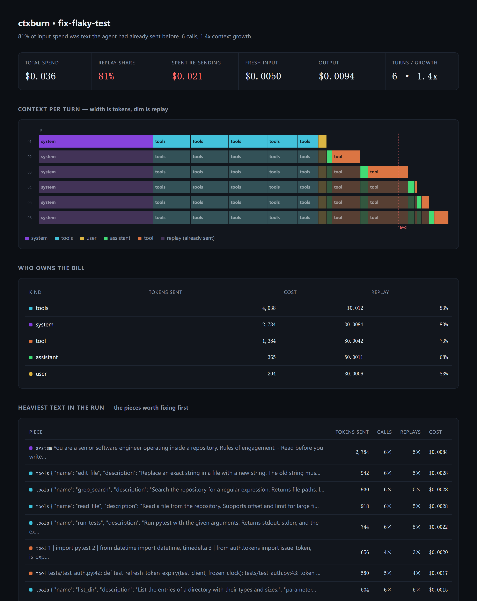

# ctxburn

English | [中文](README_CN.md)

**Where your agent's token budget actually goes.** Not what it did — what it paid to say it.

A 8-turn coding agent re-sends its system prompt, its tool schemas, and its entire
message history on every single turn. That is not a bug, it is how the API works.
It is also, usually, most of the bill.

`ctxburn` records a run, splits every call's input tokens into **fresh** and **replay**,
prices each one, and drops the result into a single HTML file you can open offline.



```
81% of input spend was text the agent had already sent before. 6 calls, 1.4x context growth.
```

## Install

```bash
pip install ctxburn          # or: uvx ctxburn
```

Zero dependencies. Python 3.10+.

## Use it in 30 seconds

```python
import ctxburn

ctxburn.watch("run.jsonl")   # patch openai + anthropic clients

# ... your agent runs completely unchanged ...
```

```bash
ctxburn report run.jsonl -o report.html
```

Open `report.html`. No server, no upload, no account.

Works with three endpoints: `openai` chat completions, `openai` **responses**
(the format OpenAI now recommends, including streamed runs), and `anthropic`
messages.

Streaming is captured for chat completions when you pass
`stream_options={"include_usage": True}`; otherwise those calls are skipped with
a warning instead of being guessed at. Responses streaming is captured from the
final `response.completed` event.

One case it refuses to fake: if you use `previous_response_id` or `conversation`,
the history lives on the server, so the request body only carries the new turn
while usage still bills the whole thing. The per-segment split is not
attributable there, so those calls get a note and the report shows a banner.

No API key? Kick the tires on the bundled synthetic run:

```bash
ctxburn demo -o demo.jsonl && ctxburn report demo.jsonl -o demo.html
```

## What the numbers mean

For every LLM call, `ctxburn` walks the context it sent and asks one question per
piece: *have I seen this exact text in an earlier call of this run?*

| term | meaning |
|---|---|
| **fresh** | tokens sent for the first time. The only input you had to pay for. |
| **replay** | tokens that were already sent in an earlier call and are being sent again. |
| **cached** | replay tokens the provider billed at the discounted prefix-cache rate. |

Replay is not automatically waste — some of it is unavoidable, and caching makes
much of it cheap. But you cannot optimize what you cannot see, and a 60–90% replay
share is the normal starting point for a long agent loop.

## Why not a tracing tool

Tracing tools answer *"what happened at 14:03"*. They render a timeline and let you
click a span. With 400 spans you can find the slow one.

They do not answer *"how much of this run was the same 900-token preamble, 40 times"*.
That is an aggregation question, and aggregation needs a different view. CPUs had
the same problem, and the flame graph solved it.

| tool | question it answers |
|---|---|
| Langfuse / Phoenix / LangSmith | what happened on turn 7 |
| [agentpprof](https://github.com/eunomia-bpf/agentsight) | which *kind of task* burned the budget across many runs |
| **ctxburn** | which part of *this context* is being re-billed, and how much |

ctxburn is complementary: it eats the same call stream and only cares about the
composition of each request.

## How the split is computed

Providers report `usage.input_tokens` per call; they do not report how much of it was
your system prompt versus the tool result you pasted in at turn 3. So:

1. Every context piece is fingerprinted by content (`kind` + text, blake2b).
   First sighting in the run → fresh. Any later sighting → replay.
2. Piece sizes are estimated by a dependency-free estimator (ASCII ≈ 4 chars/token,
   CJK ≈ 1.6 chars/token) and then **scaled so they sum exactly to the provider's
   reported total**. The whole is exact, the split is approximate.
3. Each piece is priced with a built-in price table (`src/ctxburn/pricing.py`),
   honoring `cached_tokens` at the discounted rate.

Override prices for anything newer than the table:

```bash
ctxburn report run.jsonl --set-price "my-model-2027=1.0,4.0,0.1"
```

## Honest limitations

- The split between pieces is estimated; only the per-call total is authoritative.
- Prices are reference values. They move. Override them.
- Text is stored verbatim in the trace by default (it is how replay is detected).
  Use `ctxburn.watch(..., keep_content=False)` to truncate bodies to 400 chars.
- One trace = one run. Cross-run aggregation is deliberately out of scope.

## License

MIT
