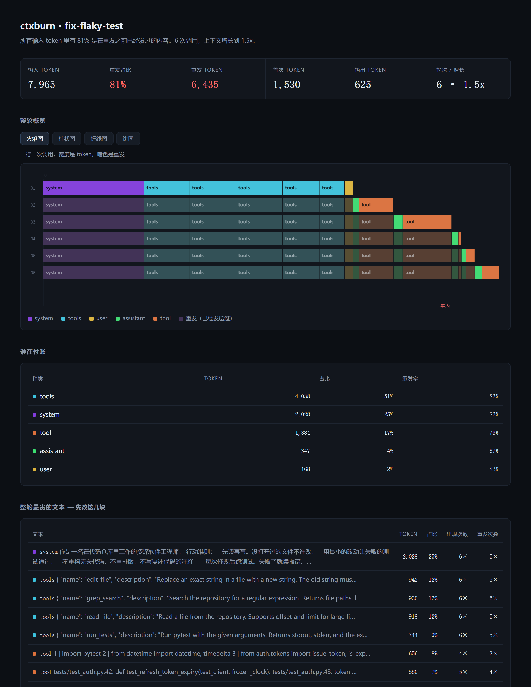

# ctxburn

[English](README.md) | 中文

**看清一次 agent 运行的上下文窗口到底装了什么。** 不是它干了什么，是它发出去的东西里有多少是之前已经发过的。

八轮的 coding agent，每一轮都会把 system prompt、工具 schema、以及此前全部的消息历史原样重发一遍。这不是 bug，这是 API 的工作方式。通常也是你付钱的大头。

`ctxburn` 记录一次运行，把每次调用的输入 token 拆成**首次发送**和**重发**，最后吐出一个离线能打开的单文件 HTML。



```
所有输入 token 里有 81% 是在重发之前已经发过的内容。6 次调用，上下文增长到 1.5x。
```

## 安装

```bash
pip install ctxburn          # 或者：uvx ctxburn
```

零依赖。需要 Python 3.10+。

## 30 秒用起来

```python
import ctxburn

ctxburn.watch("run.jsonl")   # 挂到 openai 和 anthropic 客户端上

# ……你的 agent 照常跑，一行都不用改……
```

```bash
ctxburn report run.jsonl -o report.html --lang zh
```

打开 `report.html`。不用起服务，不用上传，不用注册。

支持三个端点：`openai` chat completions、`openai` **responses**（OpenAI 现在推荐的那个格式，包含流式）、以及 `anthropic` messages。

chat completions 的流式要带 `stream_options={"include_usage": True}` 才会被记录，否则跳过并给警告，绝不猜。responses 的流式从收尾的 `response.completed` 事件里取 usage。

有一种情况它不装：用了 `previous_response_id` 或 `conversation` 时，历史存在服务端，请求体只带新的一轮，但 usage 照样按整个历史计费。这种调用的分段归因做不了，所以它会打上标记，报告顶部挂一条提示条，而不是编一个数出来。

没有 API key？拿自带的合成运行试试：

```bash
ctxburn demo -o demo.jsonl --lang zh && ctxburn report demo.jsonl -o demo.html --lang zh
```

## 四种看法，同一份数据

页面里点着切；`--chart` 决定打开时停在哪个。

| 视图 | 画的是什么 | 回答什么 |
|---|---|---|
| **火焰图 flame** | 一行一次调用，宽度是 token，暗色是重发 | 每一轮的上下文由什么组成 |
| **柱状图 bars** | 一列一次调用，按种类堆叠，暗色是重发 | 总量怎么涨的，涨的是哪一类 |
| **折线图 lines** | 每次调用的输入总量 与 新增量 | 增长是什么形状——总量往上爬，新增几乎平着 |
| **饼图 donut** | 所有输入 token 按种类的分布 | 谁在付账，一眼看完 |

```bash
ctxburn report run.jsonl --chart line --lang zh
```

折线图是最适合拿给人看的那张：两条线从同一个点出发，然后分开，缺口越拉越大——那道口子就是重发的量，被画成了形状。

## 这些数字是什么意思

对每一次 LLM 调用，`ctxburn` 会翻一遍它发出去的上下文，对每一块问同一个问题：*这段文字，在这次运行的前面出现过没有？*

| 词 | 含义 |
|---|---|
| **fresh（首次）** | 第一次发送的 token。只有这部分是真的新内容。 |
| **replay（重发）** | 之前某次调用里已经发过，现在又发了一遍的 token。 |
| **cached（命中缓存）** | 重发里被 provider 按前缀缓存折扣计费的那部分，是重发的子集。 |

重发不必然等于浪费——有些躲不掉，而且缓存能让大部分变得很便宜。但你没法优化看不见的东西，而一条长 agent 循环的重发占比，正常起点就是 60% 到 90%。

## 为什么不直接用 tracing 工具

tracing 工具回答的是「14:03 那一秒发生了什么」。它给你一条时间线，让你点开某个 span。有 400 个 span 的时候，你找得到慢的那一个。

它不回答「这次运行里，那段 900 token 的前言，被重复发了 40 次，一共多少 token」。这是个聚合问题，聚合需要另一种视图。CPU 早就遇到过同样的问题，火焰图是那时的答案。

| 工具 | 回答什么 |
|---|---|
| Langfuse / Phoenix / LangSmith | 第 7 轮发生了什么 |
| [agentpprof](https://github.com/eunomia-bpf/agentsight) | 跨很多次运行，哪*一类任务*吃掉了预算 |
| **ctxburn** | *这次*上下文里哪一块被重复发送了，多少 |

ctxburn 是补充关系：它吃同一份调用流，只关心每次请求的构成。

## 拆分是怎么算出来的

provider 每次调用会报 `usage.input_tokens`，但不会告诉你这里面多少是你的 system prompt，多少是第三轮贴进去的那段工具结果。所以：

1. 每一块上下文按内容取指纹（`kind` + 全文，blake2b）。整次运行里第一次见到算 fresh，之后再出现都算 replay。
2. 每块的体量用一套无依赖的估算器算（ASCII 约 4 字符一 token，中日韩约 1.6 字符一 token），然后**等比缩放，让它们加起来正好等于 provider 报的总数**。整体是准的，拆分是估的。
3. `cached_tokens` 按重发块的大小加权摊到各段上，单独列出来——它是计费折扣，不是另一种上下文。

`kind` 的五个值（system / tools / user / assistant / tool）在中文报告里也保留英文，因为它们就是 trace 文件里的字段名，翻译了反而对不上。

## 只报 token，不报钱

ctxburn 不显示金额。这是故意的。

要显示美元就得有一张价格表，价格表会过期，而过期的价格表会把一个猜测包装成看起来像测量结果的东西。这里的 token 数来自 provider 自己的 `usage` 字段——是引用来的，不是建模算的。

想看钱，你自己乘一下单价就行。`ctxburn report --json` 会把每次调用、每个种类的明细全给你。

## 老实说的限制

- 块与块之间的拆分是估算出来的；只有每次调用的总数是权威值。
- trace 默认原样保存文本（重发检测靠的就是全文）。想瘦身或规避隐私，用 `ctxburn.watch(..., keep_content=False)`，正文会被截到 400 字符。
- 一份 trace 对应一次运行，跨运行聚合是刻意不做的。
- 只支持 Python。Node 或 Go 写的 agent 现在看不见，那得靠代理模式，还没做。

## License

MIT
