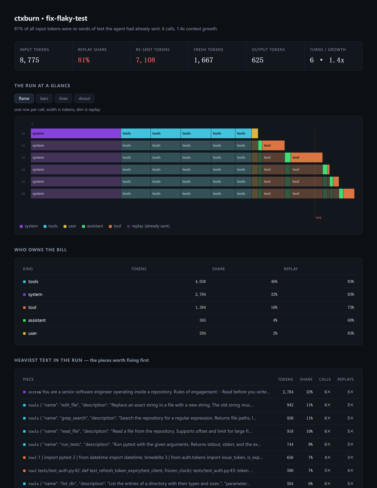

# ctxburn

[中文](README.md) | English

**Where an agent's context window actually goes.** Not what it did — how much of what it sent had already been sent.

An 8-turn coding agent re-sends its system prompt, its tool schemas and its entire message history on every single turn. That is not a bug, it is how the API works. It is also, usually, the majority of what you pay for.

`ctxburn` records a run, splits every call's input tokens into **fresh** and **replay**, and drops the result into a single HTML file you can open offline.



```
81% of all input tokens were re-sends of text the agent had already sent. 6 calls, 1.4x context growth.
```

## Install

```bash
pip install ctxburn          # or: uvx ctxburn
```

Zero dependencies. Python 3.10+.

## Use it in 30 seconds

```python
import ctxburn

ctxburn.watch("run.jsonl")   # patch the openai + anthropic clients

# ... your agent runs completely unchanged ...
```

```bash
ctxburn report run.jsonl -o report.html
```

Open `report.html`. No server, no upload, no account.

Works with three endpoints: `openai` chat completions, `openai` **responses**
(the format OpenAI now recommends, including streamed runs), and `anthropic`
messages.

Streaming is captured for chat completions when you pass
`stream_options={"include_usage": True}`; otherwise those calls are skipped with
a warning instead of being guessed at. Responses streaming is captured from the
final `response.completed` event.

One case it refuses to fake: if you use `previous_response_id` or `conversation`,
the history lives on the server, so the request body only carries the new turn
while usage still bills the whole thing. The per-segment split is not
attributable there, so those calls get a note and the report shows a banner.

No API key? Kick the tires on the bundled synthetic run:

```bash
ctxburn demo -o demo.jsonl && ctxburn report demo.jsonl -o demo.html
```

## Any language, via a proxy

`ctxburn.watch()` needs to be imported, so it only works in Python. For
everything else — a Node agent, a Go service, Claude Code, Codex — run the
recording proxy and point the client at it:

```bash
ctxburn serve -o run.jsonl          # listens on 127.0.0.1:8787

# Claude Code
export ANTHROPIC_BASE_URL=http://127.0.0.1:8787
claude

# anything OpenAI-compatible, in any language
export OPENAI_BASE_URL=http://127.0.0.1:8787/v1
```

The client keeps talking the same protocol; only the hostname changed. The proxy
routes `/v1/messages` to Anthropic and `/v1/chat/completions` plus `/v1/responses`
to OpenAI, forwards your auth header untouched, and reassembles usage out of
server-sent-events streams as they pass through.

Two details that make this work without touching the client:

- Streamed chat completions usually omit usage. The proxy adds
  `stream_options.include_usage` to the request on the way through, so the
  provider reports it and no client code changes.
- Recording happens *before* the response is handed back, so a trace file read
  right after a call returns is complete.

Point it elsewhere with `--openai-base` / `--anthropic-base` — Azure, a gateway,
a local model server — and `--default openai` if your client uses paths the
router does not recognise.

```bash
ctxburn serve -o run.jsonl --openai-base https://my-gateway.internal/v1
```

## Four ways to look at the same run

Switch inside the page; `--chart` picks which one it opens on.

| view | what it shows | answers |
|---|---|---|
| **flame** | one row per call, width is tokens, dim is replay | what each turn's context was made of |
| **bars** | one column per call, stacked by kind, dim is replay | how the total grows, and which kind drives it |
| **lines** | total input vs freshly added tokens, per call | the shape of the growth — total climbs, new stays flat |
| **donut** | every input token, by kind | who owns the bill at a glance |

```bash
ctxburn report run.jsonl --chart line
```

The line view is the one to show people: the two curves start together and then
separate, and the widening gap is the replay tax drawn as a shape.

## What the numbers mean

For every LLM call, `ctxburn` walks the context it sent and asks one question per
piece: *have I seen this exact text in an earlier call of this run?*

| term | meaning |
|---|---|
| **fresh** | tokens sent for the first time. The only input you had to send. |
| **replay** | tokens that were already sent in an earlier call and are being sent again. |
| **cached** | replay tokens the provider billed at the discounted prefix-cache rate. A subset of replay. |

Replay is not automatically waste — some of it is unavoidable, and caching makes
much of it cheap. But you cannot optimize what you cannot see, and a 60–90% replay
share is the normal starting point for a long agent loop.

## Why not a tracing tool

Tracing tools answer *"what happened at 14:03"*. They render a timeline and let you
click a span. With 400 spans you can find the slow one.

They do not answer *"how much of this run was the same 900-token preamble, 40 times"*.
That is an aggregation question, and aggregation needs a different view. CPUs had
the same problem, and the flame graph solved it.

| tool | question it answers |
|---|---|
| Langfuse / Phoenix / LangSmith | what happened on turn 7 |
| [agentpprof](https://github.com/eunomia-bpf/agentsight) | which *kind of task* burned the budget across many runs |
| **ctxburn** | which part of *this context* is being re-sent, and how much |

ctxburn is complementary: it eats the same call stream and only cares about the
composition of each request.

## How the split is computed

Providers report `usage.input_tokens` per call; they do not report how much of it was
your system prompt versus the tool result you pasted in at turn 3. So:

1. Every context piece is fingerprinted by content (`kind` + text, blake2b).
   First sighting in the run → fresh. Any later sighting → replay.
2. Piece sizes are estimated by a dependency-free estimator (ASCII ≈ 4 chars/token,
   CJK ≈ 1.6 chars/token) and then **scaled so they sum exactly to the provider's
   reported total**. The whole is exact, the split is approximate.
3. `cached_tokens` is spread across the replayed pieces by weight, and reported
   separately — it is a billing discount, not a different amount of context.

## Limitations

- The split *between* pieces is estimated; only the per-call total is authoritative.
- Text is stored verbatim in the trace by default (it is how replay is detected).
  Use `ctxburn.watch(..., keep_content=False)` to truncate bodies to 400 chars.
- One trace = one run. Cross-run aggregation is deliberately out of scope.
- `watch()` only covers the Python SDKs. Everything else goes through
  `ctxburn serve`, which sees exactly what crosses the wire — if a client keeps
  the history server-side, there is nothing to attribute and it says so.
- The proxy binds to loopback and forwards nowhere but upstream. It does see
  request bodies in the clear, though, so do not run it on a machine you do not
  trust.

## License

MIT
